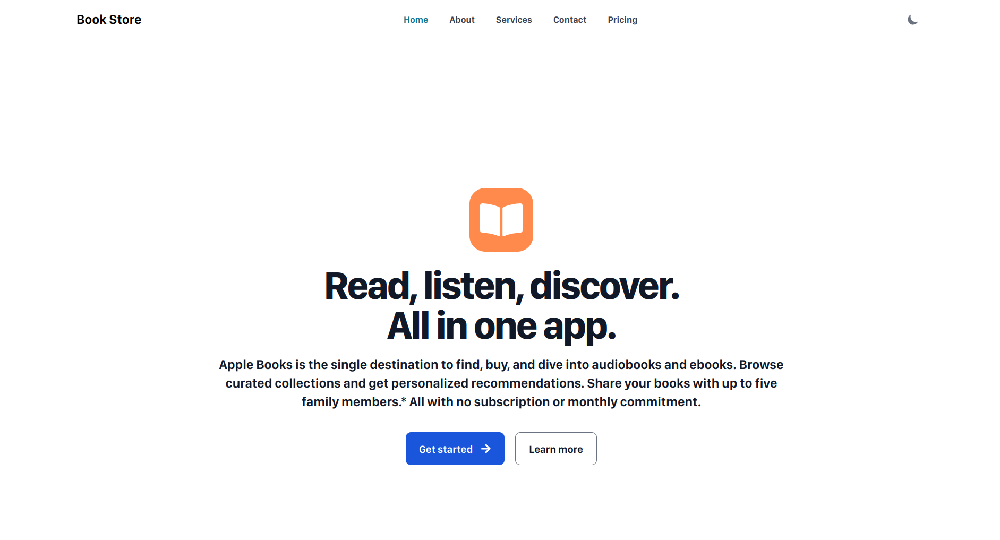

<div align="center">

  # Clone of Apple Bookstore

</div>

<br>




A responsive bookstore experience inspired by Apple Books. Browse the home page, discover ebooks and audiobooks, and explore the About, Services, Contact, and Pricing pages. The project uses static content and client-side animations; it does not require a backend or environment variables.

## Built with

- Next.js 15 App Router
- React 18
- Tailwind CSS and Flowbite React
- Framer Motion

## Requirements

- Node.js 18.18 or newer
- npm

## Set up locally

Clone the repository, move into the project folder, and install the locked dependencies:

```bash
git clone <repository-url>
cd Clone_Apple_Bookstore
npm ci
```

Start the development server:

```bash
npm run dev
```

Open [http://localhost:3000](http://localhost:3000).

## Available scripts

```bash
npm run dev    # Start the local development server
npm run build  # Create an optimized production build
npm start      # Serve the production build locally
npm run lint   # Run Next.js linting
```

## Pages

- `/` — bookstore home page
- `/about` — about the bookstore
- `/services` — reading and discovery features
- `/contact` — static contact information and email link
- `/pricing` — overview of ebook and audiobook pricing

## Deploy to Vercel

1. Push the repository to GitHub, GitLab, or Bitbucket.
2. In Vercel, choose **Add New → Project** and import the repository.
3. Keep the project root as the repository root. Vercel detects Next.js automatically; use the default install and build commands (`npm install` and `npm run build`).
4. No environment variables are required. Select **Deploy**.

For a deployment from the command line, install and authenticate the [Vercel CLI](https://vercel.com/docs/cli), then run:

```bash
vercel
```

The project uses Next.js image optimization and the standard Next.js server output, so it should be deployed as a Next.js project rather than as a static export.
